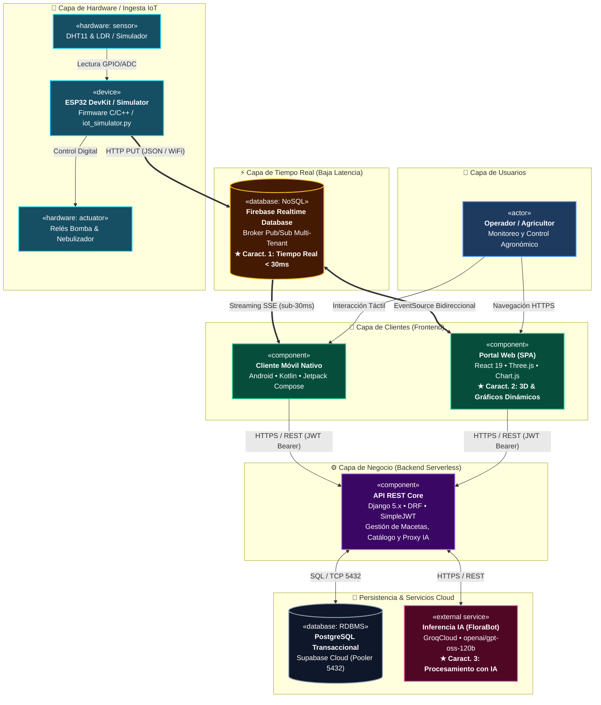

# SmartGarden — Informe de Valor y Decisiones Técnicas (Evaluación Sumativa 4)

**Asignatura:** Programación Backend  
**Institución:** INACAP  
**Integrantes:** Alexander Cortés y Angelo Zamora  
**Alcance Evaluativo:** Backend Django REST y Cliente Web Consumidor  
**URLs en Producción:**  
* **Portal Web (Cliente Consumidor):** [https://smart-garden-web-react.vercel.app](https://smart-garden-web-react.vercel.app)  
* **API REST (Backend Django):** [https://smart-garden-api-django.vercel.app](https://smart-garden-api-django.vercel.app)  
* **Documentación Swagger / OpenAPI:** [https://smart-garden-api-django.vercel.app/api/docs/](https://smart-garden-api-django.vercel.app/api/docs/)  

---

## 1. Problema de la Organización y Usuarios Objetivo

### El Problema
El monitoreo y cuidado de cultivos y especies botánicas requiere procesar variables ambientales críticas (temperatura, humedad de sustrato y radiación lumínica) para prevenir la asfixia radicular por sobre-riego o la marchitez por estrés hídrico. Sin embargo, las soluciones backend tradicionales presentan dos deficiencias:
1. **Desconexión entre datos crudos y toma de decisiones:** Los sistemas exponen tablas de telemetría numéricas que el usuario común no sabe interpretar en términos agronómicos ("¿Qué significa 22% de humedad para un limonero?").
2. **Latencia y recarga de página:** Los backends basados exclusivamente en sondeo REST periódico obligan al usuario a refrescar la interfaz para observar cambios de estado en actuadores o emergencias.

### Usuario Objetivo
* **Jardineros urbanos y aficionados a la botánica** que requieren supervisar de manera remota e intuitiva sus macetas y plantas.
* **Operadores de huertos e invernaderos** que necesitan dosificar agua en mililitros exactos, detener actuadores en caso de emergencia global (E-STOP) y recibir asesoría agronómica experta automatizada con base en datos reales.

---

## 2. Decisiones Tecnológicas y Arquitectura Backend

Para la Evaluación Sumativa 4, la arquitectura desacoplada integra un backend robusto en **Django REST Framework** conectado con servicios en la nube y un **cliente consumidor web en React**:

### Justificación de las Integraciones Avanzadas

| Característica Avanzada | Tecnología Elegida | Justificación Técnica y de Negocio |
| :--- | :--- | :--- |
| **1. Inteligencia Artificial** | **GroqCloud (`openai/gpt-oss-120b`)** | Inferencia de ultra-baja latencia (< 600 ms). FloraBot no es un chatbot genérico: el backend recibe y valida un payload estructurado con `plant_context` (telemetría viva de humedad de suelo, temperatura, luz y los umbrales fisiológicos de la especie), diagnosticando la condición real de la planta y sugiriendo acciones orgánicas. |
| **2. Datos en Tiempo Real** | **Firebase Realtime Database (RTDB)** | Latencia sub-30ms vía streaming (Server-Sent Events). Permite la propagación instantánea de telemetría y el accionamiento bidireccional de actuadores (bomba de agua dosificada y Parada de Emergencia E-STOP) sin recargar la página y sin saturar el backend relacional. |
| **3. Modelos 3D y Gráficos** | **Three.js (WebGL) + Chart.js** | El Gemelo Digital 3D reacciona directamente a la telemetría de la API (oscurece o aclara el sustrato según humedad, anima decaimiento por sequía y rota en 360°). Chart.js proyecta las curvas de 24 horas y 7 días contrastadas contra los límites biológicos tolerables de la planta. |

---

## 3. Seguridad y Protección de Credenciales en Backend

* **Principio de Mínimo Privilegio y Ocultamiento de Secretos:** Las claves maestras (`GROQ_API_KEY`, `DATABASE_URL`, `DJANGO_SECRET_KEY`, `PLANT_API_KEY`) residen exclusivamente en variables de entorno del servidor en Vercel, nunca expuestas al cliente ni a repositorios.
* **Archivos `.env.example`:** Se suministran plantillas limpias tanto en `API-Django/.env.example` como en `Web-React/.env.example`.
* **Aislamiento Multi-Tenant Estricto:** Cada usuario autenticado con JWT solo puede consultar, mutar o eliminar sus propios módulos y macetas (`queryset.filter(user=request.user)`).

---

## 4. Limitaciones Técnicas y Manejo de Cuotas Gratuitas

| Servicio / Capa | Cuota Gratuita Actual (Free Tier) | Estrategia de Mitigación y Optimización |
| :--- | :--- | :--- |
| **GroqCloud Inferencia** | Hasta 30 peticiones/minuto y 14,400 solicitudes/día. | Limitación del historial de chat a los últimos 6 turnos para optimizar tokens de entrada; prompt de sistema conciso y eficiente. |
| **Firebase RTDB** | 1 GB de almacenamiento y 10 GB/mes de transferencia. | Estructura plana JSON segmentada por operador (`/telemetria/{user}/actual.json`), enviando solo deltas de sensores y estado de actuadores. |
| **Supabase PostgreSQL** | 500 MB y pooler de conexiones IPv4. | Creación de índices en claves foráneas y campos temporales para respuestas en menos de 20 ms. |
| **Vercel Serverless** | Timeout de 10s por función serverless. | Tiempos de respuesta de Django y Groq optimizados (< 1.2s total por consulta end-to-end). |

---

## 5. Valor Agregado Comprobable y Mejoras Futuras

### Valor Agregado Comprobable
1. **Auditoría Agronómica Contextual:** Al presionar *"¿Cómo está mi planta ahora mismo?"*, el backend cruza la telemetría con los límites de la especie y entrega una respuesta agronómica precisa.
2. **Control Seguro de Actuadores:** La parada de emergencia (E-STOP) corta los actuadores a nivel global en menos de 30 ms.
3. **Experiencia de Usuario Pulida:** Diálogos modales flotantes nativos, onboarding guiado de 6 pasos y asistente FloraBot con animaciones fluidas y soporte táctil móvil.

### Mejoras Futuras
* **Inferencia Multimodal en Backend:** Integración de Google Gemini Flash en Django para procesamiento de imágenes de hojas y plagas.
* **Predicción Meteorológica:** Cruce de datos con APIs meteorológicas para suspender dosificaciones de riego ante pronósticos de lluvia.
